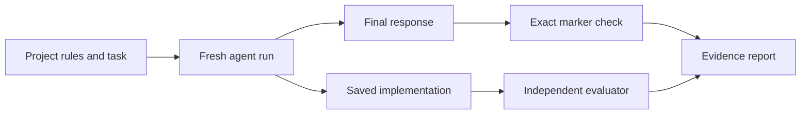

# Canary Lab

A reproducible experiment and visual evidence explorer for **The Art of the Canary in the Age of AI**, a dev.to article about instruction canaries in AI-assisted development.

The main study is complete: **30 attempts, all feature and rule checks passed; all 15 marker-enabled responses matched exactly.** Because neither marker compliance nor checked behavior varied, this study cannot establish whether the marker distinguishes failures or provides early warning.

## Read and explore

- [Article draft](article/devto.md), with the psychedelic canary cover.
- [Evidence explorer](artifacts/main-01/explorer.html): instructions, task, response, code diff, and check results for each run.
- [Standalone statistical report](artifacts/main-01/report/report.html) and [machine-readable report](artifacts/main-01/report/report.json).
- [Independent results audit](docs/results-audit.md).
- [Run guide](docs/running.md) and [publishing notes](article/PUBLISHING.md).

The article is published on [dev.to](https://dev.to/copyleftdev/the-art-of-the-canary-in-the-age-of-ai). The article draft in this repo (`article/devto.md`) is the source of truth.

## What the experiment measures

A small Python booking module has three requirements: reservations cannot overlap for the same room, timestamps use explicit offsets and normalize to UTC, and rejected operations preserve existing bookings. Agents independently add rescheduling, availability queries, or atomic batch booking.

Condition A receives the project rules. Condition B receives the same rules plus an exact response-marker instruction. Five repetitions of each task and condition produce thirty planned attempts. The model configuration is Codex CLI 0.166.0, `gpt-6-astra`, high reasoning effort, and a 240-second limit per attempt. The provider's underlying backend revision is unavailable.



A marker, a completed feature, and passing rule checks remain separate observations. Instructions and evaluator-owned tests are isolated during generation. Evaluation runs in a separate container with no network or credentials.

## Results

| Task | A feature and rule passes | B feature and rule passes | Exact B markers |
| --- | --- | --- | --- |
| Rescheduling | 5/5 | 5/5 | 5/5 |
| Availability | 5/5 | 5/5 | 5/5 |
| Atomic batches | 5/5 | 5/5 | 5/5 |

All thirty main attempts completed with observable final responses and evaluable behavior. No failed attempt was replaced. The fifteen control runs have no marker and are excluded only from the marker/rule comparison table.

The [stopped runtime pilot](artifacts/pilot-01/amendment-dated.json), [six corrected pilots](artifacts/pilot-02/report/report.html), and [sixteen calibration cases](artifacts/calibration/summary.json) remain separate datasets. The stopped pilot emitted a marker while a missing execution helper prevented implementation. It is not a main-study booking-rule failure.

## Run locally

Python 3.11 or newer is sufficient for development tests. Docker is required for isolated evaluation and agent trials. There are no third-party Python dependencies.

```sh
python3 -m unittest discover -s tests -v
python3 -m lab.runner report artifacts/main-01
python3 -m presentation.build artifacts/main-01
python3 -m lab.runner replay artifacts/main-01 reschedule-01-B
```

Report generation and replay require no model calls. Replay verifies the saved source and snapshot hashes and uses the archived evaluator. Preserve the recorded Docker image for replay. The [run guide](docs/running.md) explains image setup, authentication, new pilot cohorts, and main-study freezing.

## Project records

- [API contract](docs/contract.md) and [precollection protocol](docs/experiment.md).
- [Frozen main plan](artifacts/main-01/plan.json), including source and runtime hashes.
- [Engineering, methods, and editorial review decisions](docs/review.md).
- [Article fragments](notes/fragments.md) and [cover prompts](article/assets/README.md).

The protocol text preserves the design written before collection; the frozen plan and readiness record identify the version actually run. The evidence viewer was added as a presentation layer without changing the frozen evaluator or scoring. Raw artifacts are ignored by Git and included separately in the local delivery bundle.
